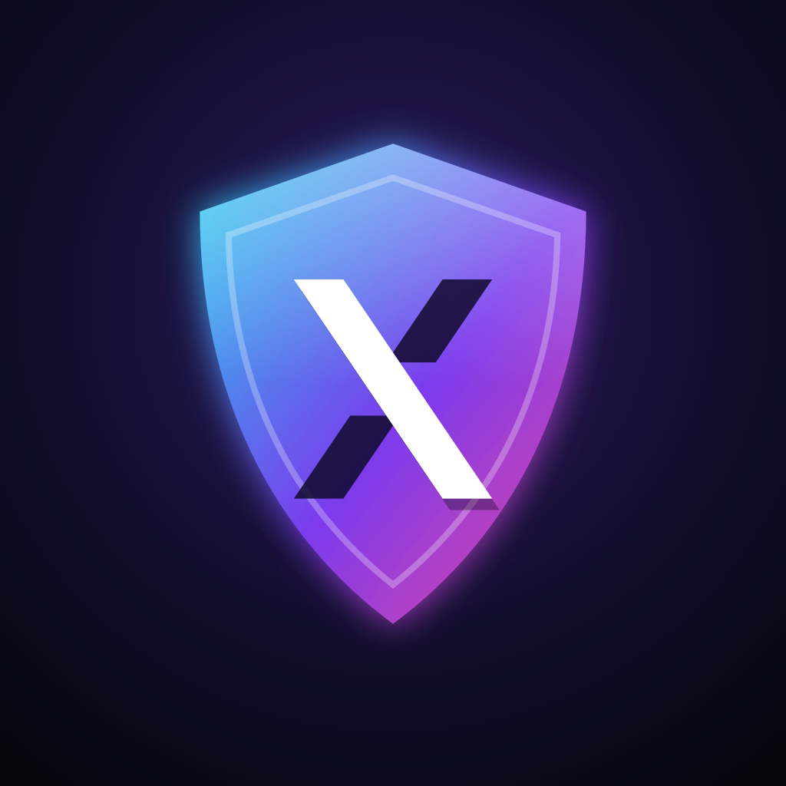

<p align="center">
  
</p>

<h1 align="center">ShadeX VPN</h1>

<p align="center">Açık kaynaklı, ücretsiz, reklamsız Android VPN. Flutter ile yazıldı.</p>

<p align="center">
  <a href="../../releases/latest"><b>⬇️ Son APK'yı indir</b></a>
</p>

## Özellikler

- **Ücretsiz sunucular:** [VPN Gate](https://www.vpngate.net) (Tsukuba Üniversitesi) gönüllü sunucuları otomatik listelenir. Kayıt ve reklam yok.
- **Tek dokunuş:** büyük bağlan düğmesi; bağlıyken nabız animasyonu, süre sayacı, indirme ve yükleme miktarı ile hızı.
- **Hızlı bağlan:** en iyi sunucuyu seçip doğrudan bağlanır.
- **Sunucu seçici:** ülke arama; *Önerilen / En hızlı / En düşük ping* sıralaması; renkli ping rozetleri.
- **IP kontrolü:** bağlanmadan önce gerçek IP'ni, bağlandıktan sonra VPN IP'sini ve ülkesini gösterir.
- **Kendi sunucun:** menüden herhangi bir `.ovpn` dosyasını (gerekirse kullanıcı adı ve şifreyle) kullanabilirsin. Uygulama bunu hatırlar.
- **Taşma yok:** küçük ekranda içerik kayar, büyük yazı boyutunda düzen bozulmaz.

## APK

Her `main` gönderiminde GitHub Actions APK'yı derler ve **Releases** sayfasına koyar.

Elle derlemek istersen ([Flutter](https://docs.flutter.dev/get-started/install) ve Android SDK gerekir): Windows'ta `kur.bat`, Linux/macOS'ta `./kur.sh`.

```bash
flutter create --platforms=android --org com.shadex --project-name shadex_vpn .
flutter pub get
dart run flutter_launcher_icons
dart run tool/android_kur.dart
flutter build apk --release
```

`android/` klasörü bilerek repoda yok. `flutter create` onu üretiyor, `tool/android_kur.dart` de VPN için gerekenleri ekliyor: izinler, native kütüphane ayarı, VPN Gate için HTTP izni, bildirim ikonu.

## Bilmen gerekenler

- VPN Gate sunucuları gönüllülerin bilgisayarlarıdır; hızları değişir. Biri bağlanmazsa başkasını dene.
- Operatörler bağlantı kayıtlarını bir süre tutar. Uygulama engelli siteleri açmak ve genel kullanım için uygundur, **tam anonimlik için uygun değildir**.
- Liste yüklenmiyorsa vpngate.net ağında engelli olabilir. Bu durumda kendi `.ovpn` dosyanı kullan.

## Lisans

Kod MIT lisanslıdır. APK içindeki OpenVPN ve ics-openvpn bileşenleri GPLv2 lisanslıdır.
